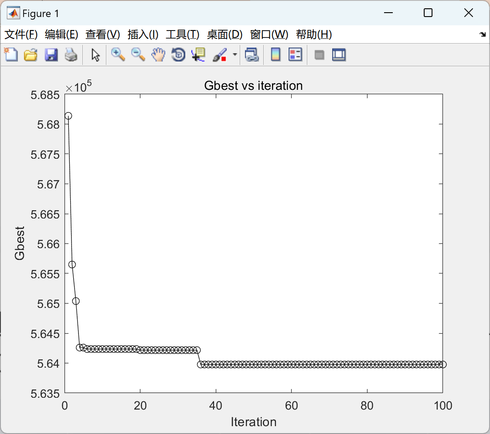
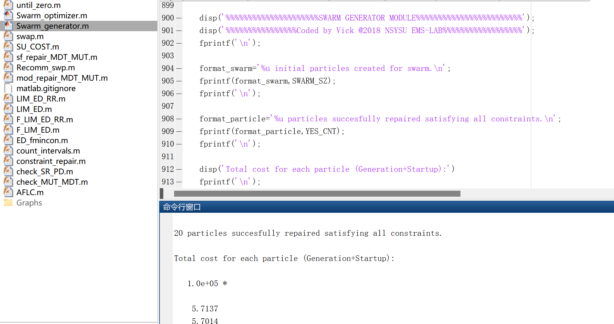

# Research on the unit commitment problem with demand response based on improved binary particle swarm algorithm (Matlab code implementation)

Research on the Demand Response Unit Combination Problem Based on Improved Binary Particle Swarm Algorithm (Matlab Code Implementation)

## Images

<!-- PAYMENT_BLOCK -->

## Get this dataset

- Payment link (Stripe): [Buy now](https://buy.stripe.com/3cs8yP7sY87d0vu9AB)
- Payment QR code: 

<!-- /PAYMENT_BLOCK -->
